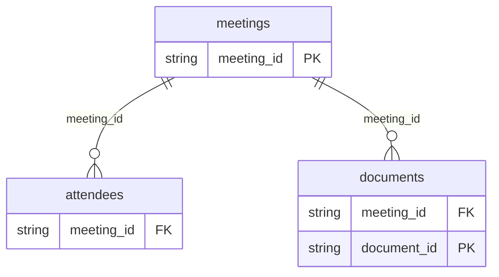

<!-- Generated by scripts/data_docs.py; edit docs/tables.toml instead. -->
# Data dictionary

Generated by `scripts/data_docs.py` on 2026-11-16 from Hugging Face `abigailhaddad/oira-eo12866-meetings` at commit `dd2f8119`. Types, row counts, non-null shares and examples are read from the parquet files; descriptions are in `docs/tables.toml` in the GitHub repo. Columns marked **(meaning not confirmed)** are ones whose meaning the source does not define.

| table | file | Hugging Face config | rows | one row is |
|---|---|---|---|---|
| `meetings` | `data/meetings.parquet` | `none (the card defines no configs)` | 1,388 | One row per EO 12866 meeting listed in reginfo.gov's meeting search, meetings dated 2025-01-20 onward. |
| `attendees` | `data/attendees.parquet` | `none (the card defines no configs)` | 14,464 | One row per line of a meeting page's attendee list. No key: some meetings list the same person twice, and those rows are kept. |
| `documents` | `data/documents.parquet` | `none (the card defines no configs)` | 1,375 | One row per handout listed on a meeting page. A byte-identical file listed under two meetings is a row under each (same `sha256`). |

## How the tables join

- `meetings.meeting_id` to `attendees.meeting_id`: Exact join. Every attendee row has a meeting; some meetings list no attendees.
- `meetings.meeting_id` to `documents.meeting_id`: Exact join. Every document has a meeting; most meetings have no handouts.

## `meetings` (`data/meetings.parquet`, config `none (the card defines no configs)`)

One row per EO 12866 meeting listed in reginfo.gov's meeting search, meetings dated 2025-01-20 onward.

Non-null and non-blank are shares of the table's rows; non-blank also leaves out empty strings.

| column | type | description | non-null | non-blank | example |
|---|---|---|---|---|---|
| `month` | string | The month (YYYY-MM) whose search the meeting came from; the month of `meeting_datetime`. | 100.0% | 100.0% | `2026-10` |
| `meeting_id` | string | reginfo.gov's meeting id, from the meeting page link. Primary key. | 100.0% | 100.0% | `1540923` |
| `rin` | string | Regulation Identifier Number of the rule the meeting is about (e.g. `2060-AW71`). | 100.0% | 100.0% | `2126-AC63` |
| `meeting_datetime` | string | The meeting page's Meeting Date/Time, as shown (MM/DD/YYYY HH:MM AM/PM); the search results' value when the page has none. | 100.0% | 100.0% | `10/30/2026 02:00 PM` |
| `list_meeting_datetime` | string | Meeting Date/Time as shown in the search results. | 100.0% | 100.0% | `10/30/2026 02:00 PM` |
| `agency` | string | The meeting page's Agency/Subagency, as shown: agency code, hyphen, acronym (e.g. `2060-EPA/OAR`). | 100.0% | 100.0% | `2126-DOT/FMCSA` |
| `rule_title` | string | The meeting page's Title (the rule's title). | 100.0% | 100.0% | `Transparency in Property Broker Transactions` |
| `stage` | string | The meeting page's Stage of Rulemaking (e.g. `Proposed Rule Stage`). | 100.0% | 100.0% | `Proposed Rule Stage` |
| `meeting_type` | string | The search results' Meeting Type column: `Completed`, `Scheduled` or `No Show`. | 100.0% | 100.0% | `Completed` |
| `requestor` | string | The meeting page's Requestor: the organization that asked for the meeting. | 100.0% | 100.0% | `Transportation Intermediaries Association` |
| `requestor_name` | string | The meeting page's Requestor's Name. | 100.0% | 99.9% | `Mitchell Hart` |
| `n_documents` | string | Number of handouts listed on the meeting page (rows in `documents` for this meeting). | 100.0% | 100.0% | `2` |
| `n_attendees` | string | Number of attendee rows on the meeting page (rows in `attendees` for this meeting). | 100.0% | 100.0% | `7` |
| `url` | string | Link to the meeting page on reginfo.gov. | 100.0% | 100.0% | `https://www.reginfo.gov/public/do/viewEO12866Meeting?viewRul...` |
| `requestor_client` | string | The meeting page's Requestor's Client, when the page shows one; usually blank. | 100.0% | 18.2% | `Anil Amlani, MolecuLight Inc.` |

## `attendees` (`data/attendees.parquet`, config `none (the card defines no configs)`)

One row per line of a meeting page's attendee list. No key: some meetings list the same person twice, and those rows are kept.

Non-null and non-blank are shares of the table's rows; non-blank also leaves out empty strings.

| column | type | description | non-null | non-blank | example |
|---|---|---|---|---|---|
| `month` | string | Same as `meetings.month` for the meeting. | 100.0% | 100.0% | `2026-10` |
| `meeting_id` | string | The meeting (`meetings.meeting_id`). | 100.0% | 100.0% | `1540923` |
| `name` | string | The attendee's name: the text before ` - ` in the attendee list. | 100.0% | 100.0% | `Caitlin Chin-Rothmann` |
| `affiliation` | string | The text after ` - `, as shown (e.g. `OMB`, `EPA`, a company or group). Not standardized. | 100.0% | 100.0% | `OMB` |
| `participation` | string | The Participation column: `Teleconference`, `In Person` or `Did Not Attend`. | 100.0% | 100.0% | `Teleconference` |

## `documents` (`data/documents.parquet`, config `none (the card defines no configs)`)

One row per handout listed on a meeting page. A byte-identical file listed under two meetings is a row under each (same `sha256`).

Non-null and non-blank are shares of the table's rows; non-blank also leaves out empty strings.

| column | type | description | non-null | non-blank | example |
|---|---|---|---|---|---|
| `month` | string | Same as `meetings.month` for the meeting. | 100.0% | 100.0% | `2026-10` |
| `meeting_id` | string | The meeting (`meetings.meeting_id`). | 100.0% | 100.0% | `1540923` |
| `document_id` | string | reginfo.gov's document id, from the download button on the meeting page. Primary key. | 100.0% | 100.0% | `1446492` |
| `listed_title` | string | The handout's title as shown on the meeting page. | 100.0% | 100.0% | `FMCSA-2023-0257-3802` |
| `file_name` | string | The file name from the download's Content-Disposition header. Blank when the server sent none. | 100.0% | 97.2% | `FMCSA-2023-0257-3802.pdf` |
| `file_name_source` | string | `Content-Disposition`, or `missing (no Content-Disposition; see listed_title)`. | 100.0% | 100.0% | `Content-Disposition` |
| `content_type` | string | The download's Content-Type header as sent (e.g. `application/pdf`, `application/docx`). | 100.0% | 100.0% | `application/pdf` |
| `file_cmd` | string | What the Unix `file` command says the downloaded bytes are (e.g. `PDF document, version 1.7`). | 100.0% | 100.0% | `PDF document, version 1.7 (zip deflate encoded)` |
| `size_bytes` | string | Size of the downloaded file in bytes. | 100.0% | 100.0% | `291908` |
| `sha256` | string | SHA-256 of the downloaded file. | 100.0% | 100.0% | `c0e248219776d02f500a5d0c4d0299fafa749cc26705345f29ffc225d715...` |
| `sha256_matches_download_log` | string | `True` if the hash computed at extraction matches the one logged at download. | 100.0% | 100.0% | `True` |
| `pages_or_slides` | string | PDF page count from pdfinfo, or slide count for a PowerPoint file. Blank for other files and Word documents. | 100.0% | 93.3% | `27` |
| `text_chars` | string | Characters of extracted text, not counting whitespace. | 100.0% | 100.0% | `66345` |
| `text_extracted` | string | `yes` (at least 50 characters and, for a counted file, at least 100 per page or slide), `partial/low` (some text, below that) or `no`. No OCR was run. | 100.0% | 100.0% | `yes` |
| `note` | string | Extraction notes, e.g. `OOXML text scraped from XML; pages not counted`, `no text layer (likely scanned/image-only); no OCR performed`, or a pdfinfo/pdftotext error. | 100.0% | 12.7% | `OOXML text scraped from XML; pages not counted` |
| `title` | string | The title from the meeting page's document list (the same text as `listed_title`). | 100.0% | 100.0% | `FMCSA-2023-0257-3802` |
| `handout_path` | string | Path of the file in this dataset: `handouts/<month>/<document_id><extension from file_name>` (`.bin` when there is none). | 100.0% | 100.0% | `handouts/2026-10/1446492.pdf` |
| `text_path` | string | Path of the extracted text in this dataset, `text/<month>/<document_id>.txt`. Blank unless `text_extracted` is `yes`. | 100.0% | 94.7% | `text/2026-10/1446492.txt` |
